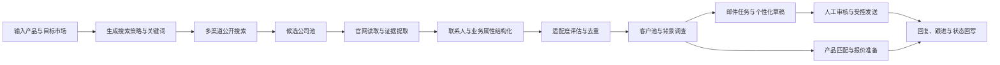
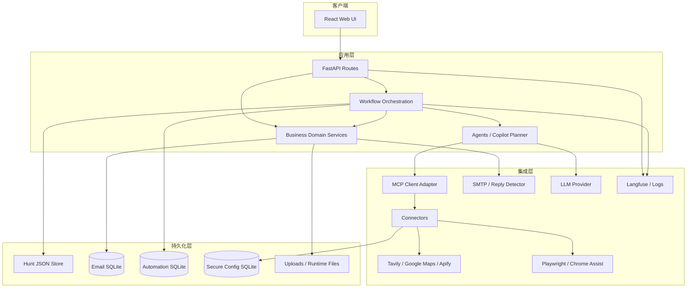
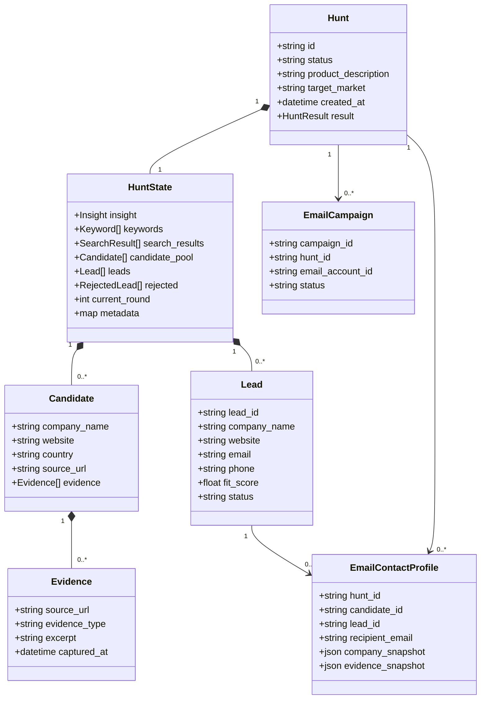
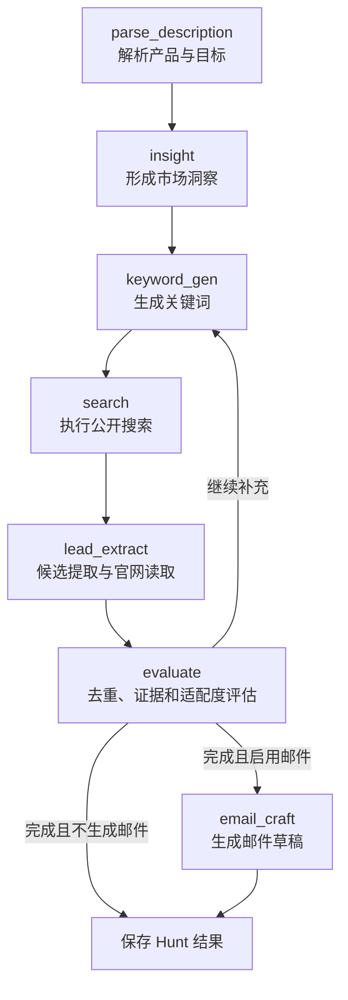
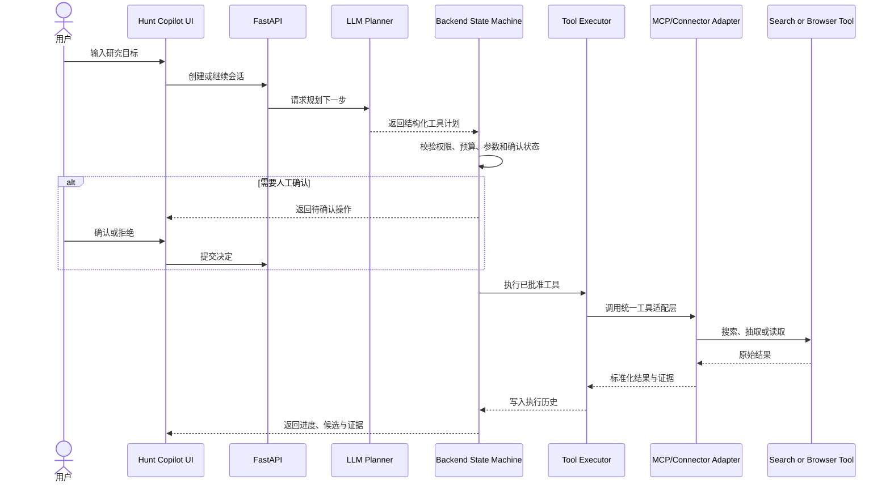
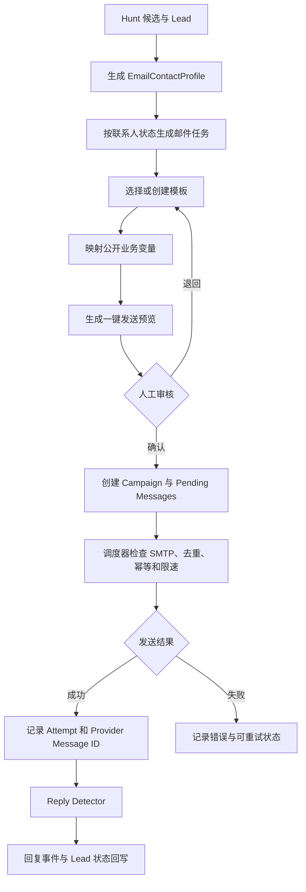
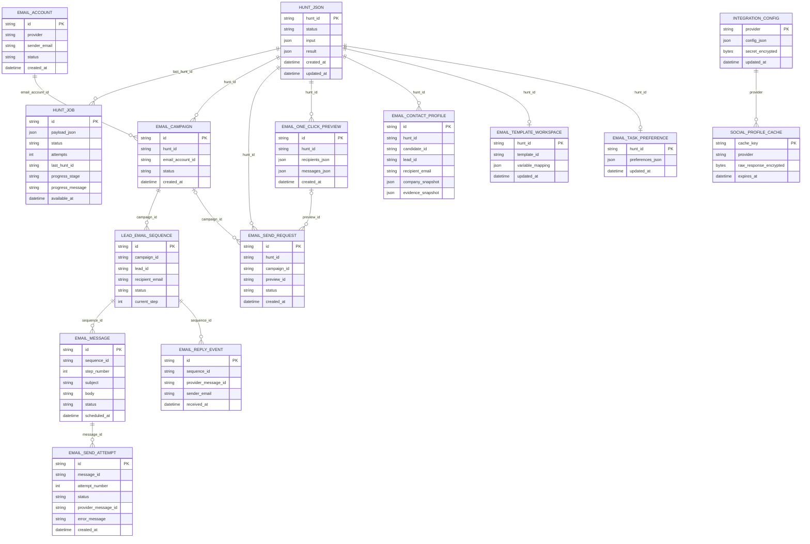
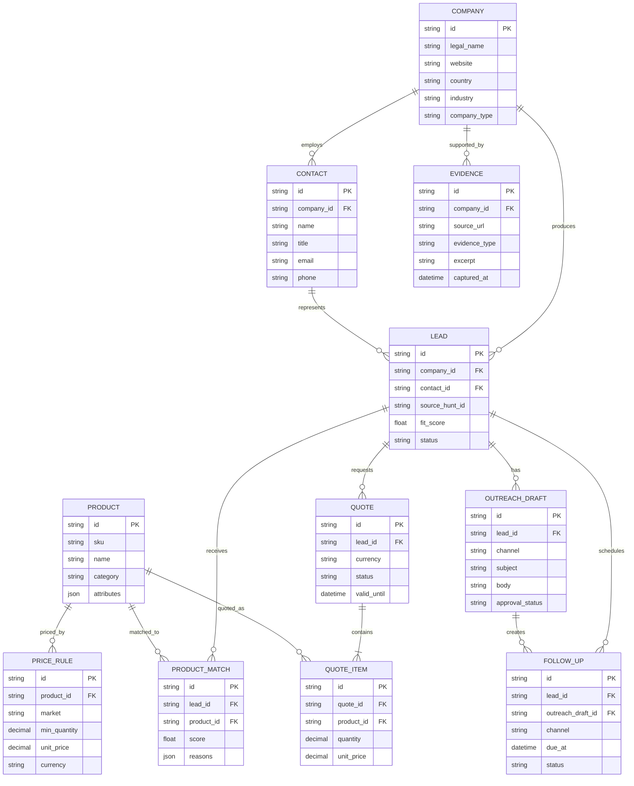

# JPS One

JPS One 是面向医疗器械外贸团队的 AI 客户开发与销售协同系统。系统将公开线索搜索、企业官网研究、联系人与证据提取、客户匹配、背景调查、邮件任务、报价准备和客户池管理组织为一条可审计的工作链路。

> 本文件是 README 审核稿。它不会自动替换仓库中的正式 `README.md`，也不会触发 GitHub 或生产环境部署。

## 1. 产品定位

JPS One 的目标不是单纯增加搜索结果数量，而是把分散的公开信息整理为可验证、可评分、可跟进的 B2B 客户资产。

核心业务链路：



### 当前能力边界

| 模块 | 当前状态 | 说明 |
|---|---|---|
| 新建搜索任务 | 已实现 | 创建 Hunt，支持自动化任务、进度和结果持久化 |
| 深度搜索 | 已实现 | 从公开网页生成候选公司，并继续读取、提取和评估 |
| 搜索工具中心 | 已实现 | Tavily、Google Maps、Apify 社媒搜索、Playwright/Chrome 辅助读取 |
| Hunt Copilot | 已实现 | LLM 负责规划，后端负责权限、预算、确认、工具执行和历史记录 |
| 客户池 | 已实现 | 从 Hunt 结果聚合、去重、筛选并保留来源证据 |
| 客户背景调查 | 已实现 | 生成客户信息与证据型背景调查输出，支持导出 |
| 邮件任务与模板 | 已实现 | 联系人快照、任务分组、模板工作区、变量映射和预览 |
| 一键代发 | 已实现受控流程 | 预览、幂等、队列、SMTP、限速、发送记录和回复回写 |
| 产品库、匹配、报价、知识库 | 基础页面/演进中 | 已有路由和领域设计，仍需继续补齐统一的数据模型与业务闭环 |
| OpenSearch 证据索引 | 接口已预留 | 完成服务与凭据配置后才能启用执行 |
| Meta 官方能力 | 受平台权限约束 | 不承诺绕过 Instagram/Facebook 的登录、权限或数据访问限制 |

## 2. 技术栈

| 层级 | 技术 |
|---|---|
| 前端 | React 18、TypeScript、Vite、TanStack Router、TanStack Query、Tailwind CSS、Radix UI |
| 后端 | Python 3.11、FastAPI、Pydantic v2、LangGraph、LiteLLM、HTTPX |
| AI 与搜索 | MiniMax/可配置 LLM、Tavily、Apify、Google Maps、Playwright、可选 MCP 工具 |
| 数据处理 | pandas、openpyxl、python-docx、PyMuPDF |
| 可观测性 | Langfuse、任务进度、工具执行记录、发送尝试记录 |
| 数据持久化 | Hunt JSON 文件、SQLite、上传文件、运行时目录、Docker Named Volumes |
| 交付 | Docker Compose、Nginx、GitHub Actions、EC2 不可变版本目录与软链接切换 |

## 3. 软件工程架构

系统按照“界面—接口—工作流—智能体—连接器—业务领域—数据与知识—运维”分层。接口层只负责验证和委派；工作流负责节点与状态推进；连接器封装外部服务；业务层持有去重、评分、客户池和邮件规则。



### 核心对象属性图

下图描述软件中的主要对象及其逻辑属性。它是领域关系图，不代表这些对象都已经成为独立的关系数据库表。



## 4. 搜索工作流

后端搜索流程由 LangGraph 管理。系统可多轮生成关键词和补充搜索；达到完成条件后，如果启用了邮件草稿能力，则继续生成邮件内容。



### Hunt Copilot 与 MCP 工具执行



可管理的工具包括：

- `web.search.tavily`、`web.extract.tavily`、`web.crawl.tavily`
- `local.search.google_maps`
- `social.search.instagram.apify`、`social.search.facebook.apify`
- `browser.read.playwright`、`browser.assist.chrome`
- `evidence.search.opensearch`、`evidence.index.opensearch`（配置完成后启用）

社媒工具默认可通过直接 HTTP 调用 Apify，以减少长任务经过 MCP 时发生的超时；MCP 传输仍作为可选执行方式。无论采用哪种传输，后端始终负责权限、预算、超时、重试和结果标准化。

## 5. 客户池、背景调查与一键邮件

客户池不是一份脱离来源的静态通讯录。它从多个 Hunt 结果动态聚合，保留来源任务、公开证据、适配度和联系人快照。

### 一键邮件受控流程



关键约束：

- “一键”表示一次确认创建受控发送任务，不表示绕过审核和安全门禁。
- 缺少邮箱的客户仍保留在客户池，但不会进入可发送队列。
- 真正可发送的消息必须同时具备有效收件地址、主题和正文。
- 预览内容必须与最终进入队列的内容一致。
- 内部评分、内部证据标签和调试信息不得直接映射到外发变量。
- 所有发送都要经过 SMTP 配置测试、幂等校验、去重、限速与发送结果记录。

## 6. 数据架构

JPS One 当前采用“JSON + SQLite + 文件卷”的轻量持久化方式。该结构适合目前的单实例部署，但不应被误解为已经完成 PostgreSQL 或完整 CRM 关系模型迁移。

### 当前物理存储

| 存储 | 主要内容 | 持久化位置 |
|---|---|---|
| Hunt JSON Store | 搜索输入、状态、候选、Lead、证据和最终结果 | `/app/data/hunts/*.json` |
| Automation SQLite | 自动化任务、认领、重试、进度和最近 Hunt | `/app/data` 持久卷中的 SQLite |
| Email SQLite | 邮箱、Campaign、Sequence、Message、Attempt、模板、预览、请求和回复 | `/app/data/email_automation.db` |
| Secure Config SQLite | 集成配置和社媒缓存，敏感内容加密存储 | `/app/data` 持久卷中的 SQLite |
| Uploads | 用户上传的产品、知识和辅助材料 | Docker Named Volume |
| Runtime | 运行时生成文件与中间产物 | Docker Named Volume |

### 当前物理/逻辑关系 ER 图

`HUNT_JSON` 是 JSON 聚合根，不是 SQLite 表。现有 SQLite 建表语句主要使用索引和应用层 ID 维持关系，当前没有完整启用数据库外键约束。图中的 `hunt_id`、`campaign_id` 等连线因此表示应用层逻辑关系。



### 目标业务关系模型

下图是产品继续演进时的统一领域模型，用于指导客户池、产品匹配、报价、跟进和 RAG 的关系化改造。它是目标架构，不表示这些实体已经全部落成独立数据表。



### 客户状态建议

统一状态集合：

`new` → `to_review` → `qualified` → `contacted` → `replied` → `interested` → `quoted` → `following` → `won` / `lost`

异常或排除状态：`invalid`、`blacklisted`。

## 7. 前端功能与路由

| 路由 | 功能 |
|---|---|
| `/` | 工作台与关键任务入口 |
| `/hunts/new` | 新建客户搜索任务 |
| `/deep-search` | 深度搜索工作区 |
| `/hunts/:huntId` | 搜索任务详情、候选、证据与后续动作 |
| `/automation/:jobId` | 自动化任务进度与执行状态 |
| `/leads` | 客户池与筛选 |
| `/products` | 产品库基础页 |
| `/matches` | 客户—产品匹配基础页 |
| `/quotes` | 报价基础页 |
| `/knowledge` | 知识库/RAG 基础页 |
| `/integration-center` | 外部服务与凭据配置 |
| `/settings` | 系统设置 |
| `/foundation` | 基础能力与系统状态 |

前端展示遵循三个原则：

1. 搜索进度、工具执行状态和失败原因必须可见，避免用户无法判断任务是否仍在运行。
2. 候选公司、联系人、评分与证据必须关联展示，不能只展示无法核验的 AI 结论。
3. 邮件发送必须区分“已生成预览”“已进入队列”“发送成功”“发送失败”和“收到回复”。

## 8. API 概览

主要接口组：

| 接口组 | 责任 |
|---|---|
| `/api/v1/health` | 服务健康检查 |
| `/api/v1/hunts` | Hunt 创建、状态、结果、列表、恢复和删除 |
| `/api/v1/deep-search` | 深度搜索 |
| `/api/v1/customer-pool` | 客户池聚合与筛选 |
| `/api/v1/automation` | 自动化任务、进度和指标 |
| `/api/v1/search-tools` | 搜索能力、工具状态与诊断 |
| `/api/v1/settings` | 集成配置、连通性测试和安全存储 |
| `/api/v1/email-*` | 邮件任务、模板、联系人、预览、Campaign、发送和回复 |
| `/api/v1/hunt-copilot` | Copilot 会话、策略和受控工具执行 |
| `/api/v1/backcheck` | 客户背景调查导出与下载 |

接口定义以 FastAPI 自动生成的 OpenAPI 文档和当前代码为准。

## 9. 生产部署拓扑

```mermaid
flowchart TB
    USER[浏览器用户] -->|HTTPS| NGINX[Nginx<br/>TLS + Basic Auth]
    NGINX -->|127.0.0.1:3000| FE[Frontend Container]
    NGINX -->|127.0.0.1:8000| BE[Backend Container]

    BE --> DATA[(ai_hunter_data)]
    BE --> UPLOADS[(ai_hunter_uploads)]
    BE --> RUNTIME[(ai_hunter_runtime)]
    BE --> EXT[LLM / Tavily / Apify / SMTP]

    GH[GitHub main] --> ACTIONS[GitHub Actions]
    ACTIONS -->|SSH + rsync| RELEASE[/opt/jps-one/releases/SHA]
    RELEASE --> ACTIVATE[activate-release.sh]
    ACTIVATE --> CURRENT[/opt/jps-one/current]
    CURRENT --> COMPOSE[Docker Compose ai-hunter]
    COMPOSE --> FE
    COMPOSE --> BE
    SHARED[/opt/jps-one/shared/backend.env] --> COMPOSE
```

当前生产环境：

- 域名：`https://jps-one.com`
- AWS 区域：`ap-southeast-2`
- EC2 实例：`i-0a2275c1e58d79847`
- 发布根目录：`/opt/jps-one`
- 当前版本链接：`/opt/jps-one/current`
- 共享配置：`/opt/jps-one/shared/backend.env`
- Docker Compose 项目名：`ai-hunter`

生产数据、上传文件、运行时文件和密钥不进入 Git 仓库，也不会被发布包覆盖。

## 10. 仓库结构

```text
.
├── backend/
│   ├── api/                  # FastAPI 路由与请求模型
│   ├── agents/               # 搜索、抽取、评估与邮件智能体
│   ├── automation/           # 后台任务队列与 Worker
│   ├── business/             # 客户池、Lead 与业务规则
│   ├── config/               # 配置与加密集成存储
│   ├── connectors/           # 搜索、浏览器、社媒和外部服务连接器
│   ├── emailing/             # 邮件任务、模板、队列、发送与回复
│   ├── graph/                # LangGraph 状态与工作流
│   └── tests/                # 后端测试
├── frontend/
│   └── src/
│       ├── components/       # UI 组件
│       ├── features/         # 业务功能模块
│       ├── routes/           # TanStack Router 路由
│       └── services/         # API 客户端
├── deploy/                   # EC2 发布与激活脚本
├── docs/                     # 架构、数据模型与专项说明
├── .github/workflows/        # CI 与生产部署
└── docker-compose.yml        # 容器编排
```

## 11. 开发与验证

### 后端

```bash
python3 -m venv .venv
source .venv/bin/activate
pip install -r backend/requirements.txt
uvicorn backend.api.main:app --reload --host 127.0.0.1 --port 8000
```

### 前端

```bash
cd frontend
npm ci
npm run dev
```

### 提交前检查

```bash
python -m compileall backend
pytest -q

cd frontend
npm ci
npm run build
```

CI 会检查 Python 编译与稳定测试集、前端生产构建，以及 `.env`、数据库、私钥、运行时目录和高置信度凭据是否被误提交。

## 12. Cursor → GitHub 终端同步

以下命令只负责把 Cursor 中已经保存到本地仓库的代码同步到 GitHub。推荐通过功能分支和 Pull Request 合并，不直接向 `main` 强推。

### 开始一次修改

```bash
git switch main
git pull --ff-only origin main
git switch -c feature/<功能名称>
```

### 检查、提交并推送

```bash
git status
git diff
git add <本次需要提交的文件>
git diff --cached
git commit -m "feat: <本次修改说明>"
git push -u origin feature/<功能名称>
```

推送后在 GitHub 创建 Pull Request，等待 CI 通过并完成审核，再合并到 `main`。合并后同步本地主分支：

```bash
git switch main
git pull --ff-only origin main
git branch -d feature/<功能名称>
```

如果修改过程中 `main` 已更新：

```bash
git fetch origin
git rebase origin/main
git push --force-with-lease
```

`--force-with-lease` 只能用于自己的功能分支，禁止用于 `main`。

## 13. GitHub → AWS EC2 自动同步

生产同步由 `.github/workflows/deploy-production.yml` 执行。Pull Request 合并到 `main` 后，GitHub Actions 自动完成：

1. 检出本次合并对应的 commit。
2. 使用专用 SSH 部署密钥连接 EC2。
3. 将代码同步到 `/opt/jps-one/releases/<commit-sha>`。
4. 排除 `.env`、数据库、密钥、数据、上传和运行时目录。
5. 调用 `deploy/activate-release.sh` 构建并启动容器。
6. 完成健康检查后，把 `/opt/jps-one/current` 切换到新版本。
7. 激活失败时保留旧版本，以便回滚。

### 必需的 GitHub 配置

Repository variable：

```text
EC2_DEPLOY_ENABLED=true
```

Repository/Environment secrets：

```text
EC2_HOST
EC2_USER
EC2_SSH_KEY
EC2_KNOWN_HOSTS
```

所有 Secret 只在 GitHub 设置页面维护，不写入 README、代码、Issue、日志或聊天记录。

### 查看自动部署

```bash
gh run list \
  --repo Fichend/jps-one \
  --workflow deploy-production.yml \
  --limit 10
```

```bash
gh run watch <RUN_ID> \
  --repo Fichend/jps-one \
  --exit-status
```

### 手动重新部署当前 main

```bash
gh workflow run deploy-production.yml \
  --repo Fichend/jps-one \
  --ref main
```

### 部署指定的已知稳定版本

```bash
gh workflow run deploy-production.yml \
  --repo Fichend/jps-one \
  --ref main \
  -f commit_sha=<已知稳定的完整CommitSHA>
```

### EC2 只读核验

```bash
readlink -f /opt/jps-one/current
docker compose -p ai-hunter \
  -f /opt/jps-one/current/docker-compose.yml \
  ps
curl -fsS http://127.0.0.1:8000/api/v1/health
```

不要在 EC2 的 `/opt/jps-one/current` 中直接修改业务代码。线上代码以 GitHub `main` 为唯一发布来源；紧急修复也应回到分支、Pull Request、CI 和部署工作流中完成。

## 14. 配置与安全原则

- 不提交账号密码、API Key、SMTP 密码、SSH 私钥、`.env`、数据库或客户数据。
- 生产环境变量只保存在 `/opt/jps-one/shared/backend.env`，并限制文件权限。
- 集成中心的敏感值加密后写入 Secure Config SQLite；加密密钥独立保存在持久卷。
- GitHub Actions 使用独立部署密钥，不复用个人 SSH 私钥。
- Nginx Basic Auth 只是入口保护的一层，不能代替应用层用户、角色和审计体系。
- 公开网络搜索结果必须保留来源 URL 和证据，不把模型推测标记为已核验事实。
- 邮件发送必须符合适用法律、平台规则、退订和反骚扰要求。

建议生产环境按周期备份以下内容：

- `/opt/jps-one/shared`
- Docker Named Volumes：data、uploads、runtime
- 当前版本 SHA、最近稳定版本 SHA 和发布日志

## 15. 当前技术债与下一步

### P0：稳定生产闭环

- 为一键代发增加端到端状态回执、失败原因展示和告警。
- 对 SMTP 连通性、队列积压、重复发送和回复检测建立可观测指标。
- 增加部署后的前后端冒烟测试，并把结果显示在 GitHub Actions Summary。
- 建立自动备份、恢复演练和明确的回滚验收标准。

### P1：提高获客精度

- 将候选召回与 Lead 精排拆开，分别评估覆盖率和准确率。
- 对关键词、来源、国家、公司类型、证据强度和产品匹配建立可解释评分。
- 建立人工标注样本与离线评测集，比较每次搜索策略修改前后的 Precision、Recall 和有效邮箱率。
- 对 Apify/Tavily/Google Maps 分别记录成本、成功率、空结果率、超时和重复率。

### P1：统一关系数据模型

- 把 Hunt JSON 中需要跨任务查询的 Company、Contact、Lead、Evidence 正规化。
- 迁移到 PostgreSQL 前先确定唯一键、合并规则、数据血缘和外键策略。
- 统一 Customer Pool、Email Profile、Campaign、Quote 和 Follow-up 的 Lead ID。
- 保留原始来源快照，确保关系化迁移后仍可追溯。

### P2：知识库、匹配与报价

- 将产品资料切分、Embedding、Rerank 和 LLM 回答封装为可评测的 RAG 流程。
- 给知识片段保存产品、版本、市场、有效期和来源元数据。
- 将产品匹配理由、报价规则和最终价格拆分，避免 LLM 直接决定商业价格。
- 完善 Product、PriceRule、ProductMatch、Quote 和 QuoteItem 的持久化与审批流程。

## 16. 相关文档

- `docs/ARCHITECTURE.md`：系统分层与工程边界
- `docs/DATA_MODEL.md`：目标业务数据模型
- `docs/EMAIL_ONE_CLICK_WORKFLOW.md`：一键邮件工作流与持久化约束
- `docs/HUNT_COPILOT_PHASE3_MCP_EXECUTOR_AND_HISTORY.md`：Copilot、MCP 执行和历史记录
- `docs/DEPLOYMENT.md`：部署约定（如仓库中已提供）

---

JPS One 的工程原则是：搜索结果必须可核验，客户数据必须可追溯，自动化操作必须可观察，外发动作必须可控制，生产发布必须可回滚。
